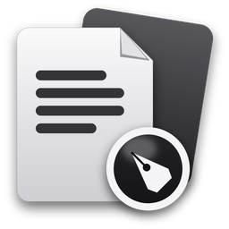

<p align="center"></p>

<h1 align="center">DeskFolio</h1>

<p align="center">A free, offline PDF tool for Windows, macOS and Linux.<br>No account, no uploads, no tracking: your PDFs never leave your computer.</p>

**Download:** [latest release](https://github.com/imjagdeep/DeskFolio/releases/latest) for Windows, macOS (Apple Silicon and Intel, signed and notarized) and Linux.

## What it does

| Tool | What you can do |
|---|---|
| **View** | Several PDFs in tabs; thumbnails, bookmarks, zoom, one or two pages, text search with highlights, reading mode; password-protected PDFs open with their password |
| **Comment & markup** | Highlight, underline, strike out, sticky notes, text boxes, freehand drawing, shapes, arrows and stamps, all as real PDF comments other readers show; a Comments list |
| **Edit** | Change the words of a line of text, move, resize, replace or delete images, add and remove links |
| **Organize pages** | Reorder by dragging, rotate, delete, extract to a new PDF, insert pages from another PDF or a blank page |
| **Page tools** | Watermark, header & footer (page numbers, dates, Bates numbers), crop, bookmarks, document properties, print, compare two versions |
| **Merge** | Join several PDFs, with optional page ranges per file |
| **Split** | By page ranges, every N pages, or one file per page |
| **Compress** | Light, Balanced or Strong: photos are re-saved smaller, text and drawings stay sharp; never makes a file bigger |
| **Fill & Sign** | Type into PDF forms (optionally lock them afterwards); add text, dates, check marks and your signature (drawn, typed or from an image, kept on your computer) |
| **Digital signatures** | Sign with a certificate (PAdES, SHA-256): make your own digital ID or import a .pfx/.p12, draw the signature box, sign; see who signed a PDF and whether it changed since |
| **Protect** | Open password (AES-256) and permissions, remove protection, remove hidden information, redact text, areas and found details (emails, phone numbers, card numbers) for good |
| **Convert** | PDF to Word (headings, paragraphs, simple tables), Excel (tables, real numbers), text or PNG/JPG pages; pictures to PDF; Word/Excel/PowerPoint to PDF using Microsoft Office or LibreOffice if installed |
| **OCR** | Make scanned PDFs searchable: the pages look the same, but their text can be found, selected and copied (English built in, offline) |

Every change can be undone while the file is open, and nothing is written to disk until you choose **Save as** (or **Save over original**, which asks first).

## Honest limits

- Digital signatures have no trusted timestamp yet (the time shown is the signer's own clock), and the certificate chain isn't checked against a trust list: DeskFolio trusts your own IDs and those you mark as trusted. A self-made ID shows as "not verified" in other readers until they choose to trust it; a green check everywhere needs an ID from a provider on Adobe's trusted list. Password-protected PDFs can't be signed yet.
- Sending a PDF to other people to sign is planned, not built.
- Drawn and typed signatures (Fill & Sign) are visual, like signing on paper.
- Added text uses a built-in Latin font for now; other scripts get a clear message instead of broken text.
- Compress only re-saves ordinary photos (RGB or greyscale); other image kinds are left exactly as they are.
- PDF to Word/Excel rebuilds the document from its text, so complex layouts, columns and fonts won't match exactly. Pages without text (scans) go into Word as pictures; run OCR first for editable text.
- Office to PDF needs Microsoft Office (Windows) or LibreOffice; DeskFolio doesn't include either.
- OCR reads English. Handwriting and very faint scans may not be read well.

## Building from source

Needs Node.js 22+ and Rust (stable), plus the [Tauri prerequisites](https://tauri.app/start/prerequisites/) for your system.

```sh
npm ci
npm test            # PDF operations (vitest)
npm run tauri dev   # run the app
npm run tauri build # installers in src-tauri/target/release/bundle/
```

Built with [Tauri](https://tauri.app), [pdf.js](https://mozilla.github.io/pdf.js/), [pdf-lib](https://github.com/cantoo-scribe/pdf-lib), [lopdf](https://github.com/J-F-Liu/lopdf), [tesseract.js](https://github.com/naptha/tesseract.js), [docx](https://github.com/dolanmiu/docx) and [fflate](https://github.com/101arrowz/fflate).

## More tools

Part of the DeskLab family by the same author: [DeskZero](https://github.com/imjagdeep/DeskZero) (keeps your desktop and downloads tidy) and [DeskMedic](https://github.com/imjagdeep/DeskMedic) (helpdesk toolkit for Windows). See [jaggi.cc/tools](https://jaggi.cc/tools/).

## License

MIT. Made by Jagdeep Sandhu · [github.com/imjagdeep](https://github.com/imjagdeep)
